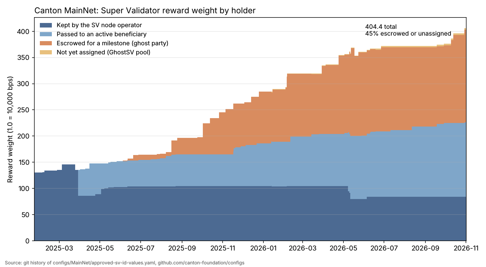
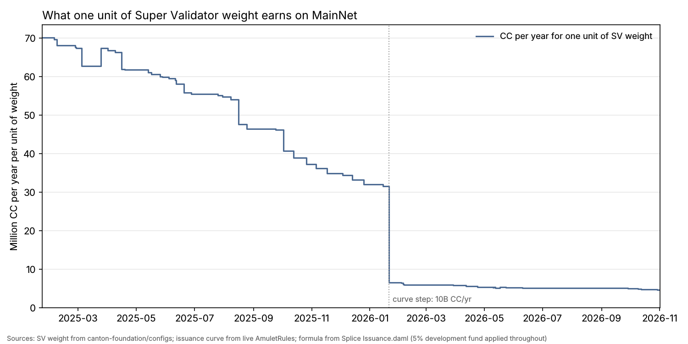
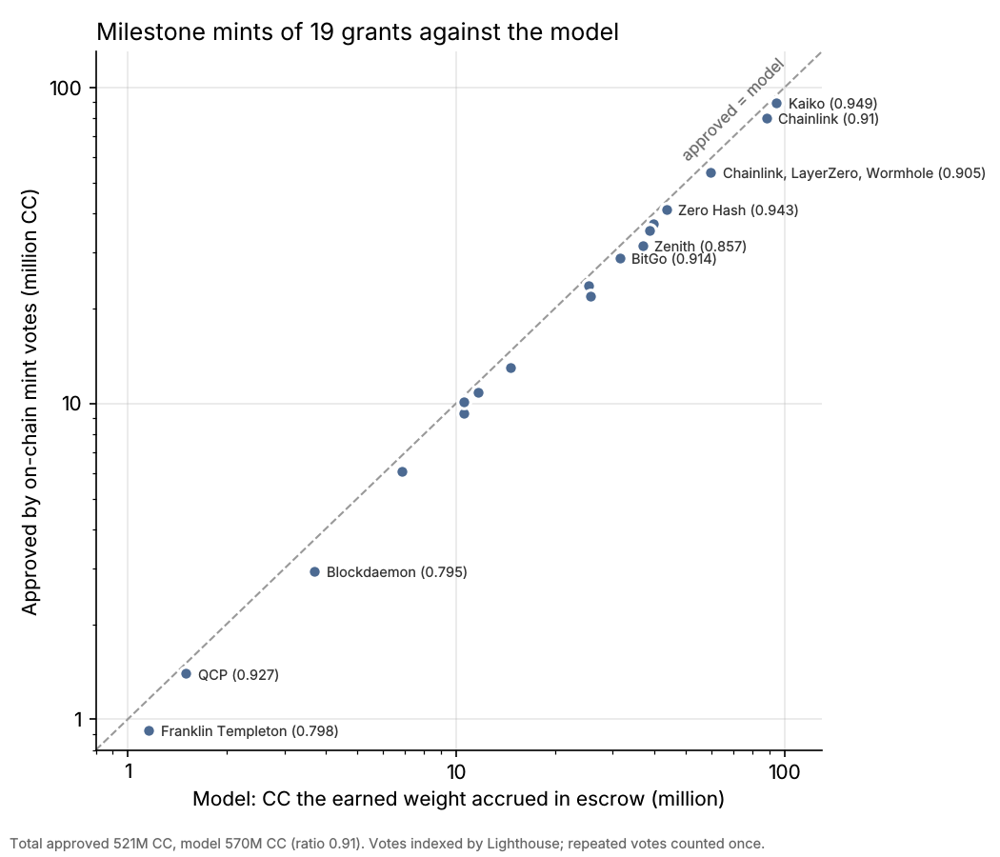
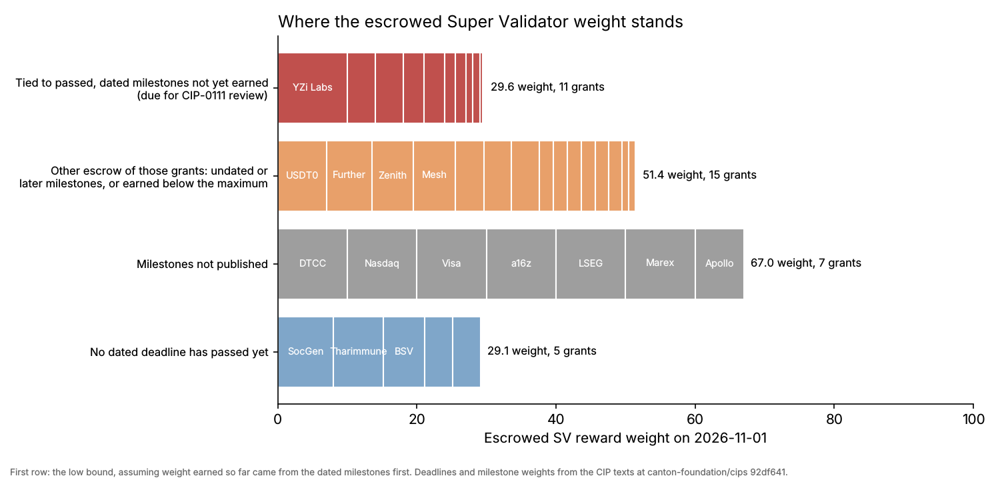

# The Ghost Weight: how much Canton Super Validator reward weight is waiting on a promise

*Furkan Akdoğan, November 2026. Code and data: [github.com/furkan3152/canton-sv-weights](https://github.com/furkan3152/canton-sv-weights). Weights are as of the config commit of 1 November 2026; on-chain data is as of 5 November 2026.*

Almost half of the reward weight on Canton's Super Validator layer does not belong to an operating Super Validator. It belongs to organisations that have been promised weight in return for future milestones, and until they deliver, the rewards attached to that weight are set aside and not minted. The design is deliberate and documented in the CIPs. What I could not find anywhere is a full account of it: how much weight is in escrow, how much CC it has accrued, how much has been paid out, and how much is overdue for review.

This piece builds that account from public data. I rebuilt the history of SV weight from every commit of the Canton Foundation's config repository. I traced the reward path through the Splice code and priced the escrowed share round by round. Then I checked the result against the on-chain votes that pay milestone rewards.

## Key findings

- Total SV reward weight grew from 130 in January 2025 to 404.45 in November 2026. Of that, 177.125 sits on 32 escrow ("ghost") parties and 3.095 in an unassigned pool: 44.6% of all weight.
- That weight receives SV reward coupons every round, but they are never claimed. They expire into the network's unclaimed-reward pool. Since escrow began in June 2025, this comes to about 1.74 billion CC. At today's issuance it adds about 847 million CC per nominal year.
- The calculation matches how milestones are actually paid. For the 19 grants that have been paid, governance approved 521 million CC against the 540 million this method computes for them.
- Of 260.5 weight ever placed in escrow, 65.3 has been earned, 15.0 removed and 3.1 released without being earned. The remaining 177.1 is still escrowed.
- Between 29.6 and 49.0 escrowed weight, across 11 grants, is tied to dated milestones whose deadlines have passed and which have not been earned. CIP-0111 requires the Tokenomics Working Group to review exactly this case. Since CIP-0111 was approved, only one removal of milestone weight has reached the chain: Monstera FZE and Woodside AI, in May 2026.
- The unclaimed pool on-chain records only an amount. It cannot distinguish escrowed rewards from any other unclaimed reward, so the escrow reserve exists only as an off-chain calculation.

## How SV rewards are paid

Every mining round, a fixed share of newly issued Canton Coin goes to Super Validators. In `Issuance.daml` (`computeIssuingRoundParameters`), the round's issuance is reduced by the Development Fund share (CIP-0082) and by the full validator and app tranches. What remains is divided by the total weight of the SV reward coupons issued that round:

```
svTranche                 = amuletToIssuePerYear / roundsPerYear × (1 − developmentFund) × (1 − validator% − app%)
issuancePerSvRewardCoupon = svTranche / total weight of the SV reward coupons issued in the round
```

Every unit of weight therefore earns the same amount, and every unit added dilutes the rest. Today the curve issues 10 billion CC per nominal year (52,560 ten-minute rounds), of which Super Validators receive 20% after the 5% Development Fund share: 36,149 CC per round. The chain agrees. Round 120,404 paid 0.0089378571 CC per SV coupon per basis point of weight; across the network's 4,044,500 basis points, that is 36,149 CC.

Issuance follows rounds rather than the calendar. The issuance curve advances one tick per round, "independently of how real world time advances", as a comment in `AmuletRules.daml` puts it. Rounds have averaged about 10.3 minutes since June 2025, so a calendar year has held about 3% fewer rounds than a nominal one. For that reason all totals here are summed round by round.

To check the formula over the whole history, I sampled every 500th round since launch. At each sample, the rate actually paid times the total weight in the config file reproduces the expected tranche:
- 182,648 CC per round before the curve step at round 78,840 (12 January 2026);
- 38,052 CC after it;
- 36,149 CC once the Development Fund began taking its share in February 2026.

The weight of each node, and how a node passes weight on to other parties ("beneficiaries"), is published in `configs/MainNet/approved-sv-id-values.yaml` in [canton-foundation/configs](https://github.com/canton-foundation/configs). The file has 121 commits since January 2025. Node totals also change on-chain through `UpdateSvRewardWeight` votes, and the two sources agree closely (see "The public file and the chain" below).

Reward weight is not voting power. Governance counts one vote per node, and a vote needs 9 of 13. The Global Synchronizer Foundation (GSF) node carries 195.3 weight, 48.3% of the total, and has one vote like every other node.

## The ghost weight

Since mid-2025, many CIPs have admitted organisations as Super Validators on a milestone basis. The organisation earns its weight by delivering an integration, a launch or a volume target. Until then the weight sits on an escrow party hosted by another node, named `<Organisation>-ghost-1` in the config file. Three validators host these parties: GSF's `GhostSV-validator-1`, MPC Holding's `MPCH-GHOSTvalidator-1` and Five North's `5nghost-mainnet-1`.



*Figure 1. SV reward weight by holder, from every commit of the config file.*

On 1 November 2026 the weight was split as follows:

| Holder | Weight | Share |
|---|---|---|
| Kept by the 13 SV nodes (11 organisations) | 83.625 | 20.7% |
| Passed to active beneficiaries | 140.605 | 34.8% |
| Escrowed on 32 ghost parties | 177.125 | 43.8% |
| Unassigned pool (`GhostSV-validator-1`) | 3.095 | 0.8% |
| Total | 404.45 | |

GSF hosts 97 of the escrowed weight on 20 parties, MPC Holding 53.125 on 7, and Five North 27 on 5. Escrow did not exist before 3 June 2025. It passed a third of all weight in November 2025 and has stayed between 31% and 45% since.

## Where the escrowed rewards go

The Splice code shows the full path.

Each round, an SV node submits its beneficiary list through `DsoRules_ReceiveSvRewardCoupon`. The contract requires that "Total beneficiary weight matches SV operator weight" and creates one `SvRewardCoupon` for each beneficiary, escrow parties included. The escrow parties never claim theirs. CIP-0066 says that "The GSF specifically disables the final minting action for all escrowed SV parties", and later CIPs say the same of every escrow host. Once the round closes, `DsoRules_ClaimExpiredRewards` expires the coupons and records their value in an `UnclaimedReward` contract, together with any expired validator and app rewards.

An `UnclaimedReward` has two fields, `dso` and `amount`, and `AmuletRules_MergeUnclaimedRewards` merges many of them into one. From that point nothing on-chain records where a given coin came from.

Milestone rewards are paid out of this pool by vote. When the Tokenomics Working Group (TWG) agrees that a milestone has been met, Super Validators vote on `CreateUnallocatedUnclaimedActivityRecord`, naming a beneficiary, an amount and a reason. An SV then allocates the record, archiving `UnclaimedReward` contracts to cover it, and the organisation mints the coins. A record that is not minted in time returns to the pool, which is why a few payouts were voted twice.

Since October 2025 there have been 53 such votes, 48 of them executed:

| Purpose | Approved |
|---|---|
| Milestone payouts (repeat votes counted once) | 532.3 million CC |
| CIP-0067 one-time allocation of historical unclaimed rewards to GSF (November 2025) | 1,617.8 million CC |
| Corrections where an external party ID had prevented minting | 8.8 million CC |

CIP-0067 handed GSF the unclaimed rewards "as of the effective date" that were "not explicitly reserved under any approved milestone-based SV reward schedule". So the escrow reserve was always a figure that someone had to calculate off-chain. CIP-0111, approved in April 2026, acknowledges the same gap. When ghost weight is removed, its coupons "should be burned to indicate the tokens associated with them are no longer in the unminted pool", and "Enabling this functionality will require a change to the Canton Coin SV Reward DAML model." As of Splice commit `2930ba1` (5 November 2026), the only choices that consume an `UnclaimedReward` are the merge and the allocation described above.

## How much it is



*Figure 2. CC per nominal year earned by one unit of SV weight. The drop at round 78,840 (12 January 2026) is the scheduled curve step from 20 to 10 billion CC a year, when the SV share also fell from 48% to 20%.*

One unit of weight earned about 73.8 million CC per nominal year in January 2025 and earns about 4.7 million today. Most of that fall is the scheduled issuance curve: had total weight stayed at 130, a unit would still earn about 14.6 million. The rest is dilution from new weight.

Escrowed and unassigned weight takes 44.6% of today's SV tranche, about 847 million CC per nominal year. Summed round by round from 3 June 2025 to round 120,400 (5 November 2026), it comes to about 1.74 billion CC. A second calculation, using the rate actually paid at each sampled round instead of the formula, gives 1.73 billion. Both include the Development Fund deduction from its activation on 12 February 2026.

These coins are not lost. They stay in the unclaimed pool until governance pays them to an organisation that met its milestones, or until a CIP-0111 reduction marks them for burning. I could not observe the pool's current balance, because the Scan API refused requests from outside its allowlist. So this analysis does not show whether the pool still covers the reserve.

## Checking the method against actual payouts

If the method is right, each milestone payout should be close to what the earned weight accrued while it was in escrow. The TWG's payout announcements credit their calculations to Noves and IntellectEU. Kaiko's published methodology for its own claim follows the same rule: split the period wherever total weight changes, and sum `hours × weight × hourly SV rewards / total weight` over each interval.



*Figure 3. For each grant, the CC its earned weight accrued in escrow by this method, against the payouts approved on-chain.*

For the 19 grants where the comparison applies, approved payouts total 521 million CC and the method gives 540 million. The ratio per grant runs from 0.82 to 1.00, with a median of 0.96. A small overestimate is expected. The method starts each grant at the config commit, while the TWG starts when an operator confirmed the weight. It also counts every round, including any a node failed to collect.

Two grants are excluded because they are paid on a different basis. Tharimmune / Canton Strategic Holdings (CIP-0102 and CIP-0114) earns most of its weight under the CIP-0114 programme. Société Générale (CIP-0115) received payouts while its escrow stayed at 8.

The agreement matters because it means the 1.74 billion CC is not a theoretical number. It is the same calculation the network already uses to pay milestones, applied to all escrowed weight. If anything, it runs a few percent high.

## What happened to the promised weight

Grouping every beneficiary entry by the CIP cited in its comment gives the history of 38 milestone grants and 84 weight changes, each linked to its commit. The code checks, grant by grant, that every unit placed in escrow is accounted for:

| | Weight |
|---|---|
| Placed in escrow | 260.5 |
| Earned and released to the organisation | 65.28 |
| Released without being earned | 3.095 |
| Removed under CIP-0111 | 15.0 |
| Still escrowed | 177.125 |

The 38 grants break down as follows:
- 5 are fully earned;
- 15 are partly earned;
- 15 have earned nothing yet;
- 2 were removed;
- 1, Fireblocks, has a closed escrow with 2.58 of its 5 earned.

Where a milestone was met, the first one typically came about three months after the grant (median 92 days).

The two removals are Monstera FZE (5) and Woodside AI (10). Both CIPs were marked withdrawn on 6 May 2026, the on-chain vote took effect on 15 May, and the config file followed on 17 May, about nine months after the weight was first added.

Partial earnings leave weight behind. When an organisation earns less than the escrow released for a milestone, the difference is not removed from the network. Since January 2026 it has been moved to the unassigned `GhostSV-validator-1` pool; before that it sat with GSF's own share. Fireblocks is the clearest case: its escrow is closed, but 2.42 of its weight is now in that pool. With smaller remainders from Ubyx, Talos, BitGo and Wormhole, the pool holds 3.095 weight. That weight still accrues about 14.5 million CC per nominal year to the unclaimed pool.

Separately, CIP-0105 lock enforcement has withheld and restored active weight several times, for Taurus, Ledger, Quantstamp, Elliptic and DFNS. Net of reversals, 1.2 weight of milestone grants is withheld today.

### Deadlines

Most CIPs give each milestone a deadline, often "+180 days from CIP approval". Many milestones have no fixed date, though, such as adoption targets that run from a launch. And a passed date says nothing about whether the milestone was met. To separate these cases, I recorded the maximum weight of each dated milestone from the CIP texts. I then bounded, for each grant, the escrow tied to dated milestones that are past their deadline and not yet earned. The low bound assumes that weight earned so far came from those milestones first. The high bound assumes it came from undated ones.



*Figure 4. Escrowed weight on 1 November 2026 by deadline status. The first row uses the low bound.*

| Status | Grants | Escrowed weight |
|---|---|---|
| Tied to passed, dated milestones not yet earned (low bound) | 11 | 29.6 |
| Other escrow of grants with a passed deadline | 15 | 51.4 |
| Milestones not published | 7 | 67.0 |
| No dated deadline has passed yet | 5 | 29.1 |

Several grants that look overdue at first glance are not. Zero Hash, Zenith, Republic, Talos and Taurus met their dated milestones. So did the three CIP-0065 bridges, apart from 0.4 of Wormhole's integration weight. Their remaining escrow belongs to milestones with no fixed date, and CIP-0099 also extended Zero Hash's adoption period. The largest amounts tied to passed, dated milestones are:
- YZi Labs, 10, whose CIP-0081 programme term ended on 26 September 2026;
- Mesh, 4;
- Blockdaemon, 4;
- the USDT0 issuer, 3;
- Zodia Custody, 3.

These bounds depend on reading milestone weights from free text, and a few grants are irregular; ChainSafe's escrow, for example, was set below its CIP maximum. The full per-grant table is in `data/deadlines.csv`.

A passed deadline does not forfeit the weight. CIP-0111 says that "At a minimum, the TWG must review SVs for potential weight reduction whenever the deadline for a milestone associated with a milestone-based SV CIP passes." A reduction then needs a TWG recommendation, an off-chain SV vote and an on-chain vote. Deadlines can be extended, as CIP-0099 did for Zero Hash, and the TWG once reset Woodside's approval date.

Here is what the public record shows. Lighthouse indexes every on-chain vote since July 2025, together with its stated reason. Among those votes, the only one that reduced milestone weight under CIP-0111 is the Monstera and Woodside removal. In the ten "Tokenomics Outcomes" posts on the tokenomics-announce list between 9 September and 29 October 2026, I found no CIP-0111 review, extension or reduction. Reviews may well have happened without leaving a public trace, but if so, the community cannot see them.

Seven further grants, holding 67 weight, have not published their milestones. CIP-0110, for instance, says Apollo's "specific commitments, timelines, and commercial details will remain confidential". For these grants there is no way to tell from outside how close the organisation is to earning its weight.

## The public file and the chain

The config file is a public mirror of settings that take effect elsewhere. Node totals change through on-chain votes, and beneficiary lists live in each node's own configuration. Comparing the file with the chain gives a sense of how far it can be trusted.

Lighthouse records 69 executed weight votes. Seventeen carry a placeholder date from the day indexing began; the other 52 have real effective times from May 2025 onwards. For 51 of those 52, the file reaches the same node total within days, with a median lag of 0.7 days and a maximum of 9.6. The exception is a GSF value of 192.6, set by a CIP-0105 enforcement on 1 May 2026, which the file never showed. A later commit "align[ed] public extraBeneficiaries with the actual SV configuration".

The sampled rounds show the same lags from the other side. In late January 2026, for example, the chain was already paying as if GSF's increase to 185.5 (effective 26 January) was in place; the file showed it on 4 February. Over the whole period these lags move the escrowed total by less than 1%.

Three smaller issues came up:

- **A wrong field name.** From 5 February to 4 April 2026, nine commits gave Five North's beneficiary weights under `rewardWeightBps` instead of `weight`, until upstream #328 fixed it. The on-chain totals were correct throughout. My first parse of the file misread those lines, and it was the comparison with on-chain votes that exposed the error.
- **Lists longer than the node's weight.** On four commits, GSF's beneficiaries in the file added up to more than the node's weight: by 0.45 three times in January and February 2026, and by 2.9 once in May.
  - The contract would reject such a list, so the SV app's `weightDistributionForSv` caps the last entries against the on-chain weight.
  - Had the node's real configuration matched the file in January, the DTCC escrow party would have received 9.55 instead of 10 until GSF's weight rose on 26 January.
  - The May excess equals the CIP-0105 cuts the node had already applied, so it was most likely an artefact of a stale file.
  - In both cases only escrow parties could have been affected.
- **A documentation mismatch.** The [tokenomics reference](https://docs.canton.network/overview/reference/tokenomics-of-gs) says that "Unclaimed rewards beyond all tranches go to SV rewards". In the code, the SV tranche is computed after the full validator and app tranches are deducted (`Issuance.daml`). Unused issuance from all three goes to an `UnclaimedReward` contract (`AmuletRules.daml`, around line 600).

## Suggestions

1. **Publish an escrow ledger.** A single page generated from the config repository and the payout votes would make the whole system legible. For each grant it would list the CIP, escrowed and earned weight, CC accrued, CC paid out and milestone deadlines. The code in this repository already produces it.
2. **Record CIP-0111 reviews publicly.** A one-line outcome for each review would show that the process is working for the weight tied to passed milestones: met, extended to a date, or reduced.
3. **Give the unclaimed pool provenance, or implement the burn CIP-0111 calls for.** As long as `UnclaimedReward` holds only an amount, the escrow reserve depends on an off-chain calculation.
4. **Decide what happens to weight left behind by partial earnings.** It should either be removed, as the CIPs describe for unmet milestones, or have a stated purpose.
5. **Check the public file against the chain automatically.** A CI job comparing node totals with `DsoRules` and validating field names would have caught each issue in the previous section on the day it happened.

## Method and limits

Weights come from every commit of `approved-sv-id-values.yaml`. A party counts as escrow if its name contains "ghost" or "escrow", or if it is hosted on a ghost validator; `GhostSV-validator-1` is the unassigned pool. Before March 2025 the file did not list beneficiaries, so early weight shows as kept by the nodes.

Node totals were checked against the live on-chain `DsoRules` for all 13 nodes, and against every executed weight vote with a real effective time. Beneficiary lists are node configuration and could not be checked on-chain. The Scan API, which would expose individual coupons, refused requests from outside its allowlist.

Rewards use the formula in `Issuance.daml` and the live issuance curve, summed per round. Calendar dates are mapped to rounds with 241 sampled rounds, and the formula was checked against the paid rate at every sample. Dates are commit dates; operators may apply a change slightly earlier or later.

Payout votes and round data come from Lighthouse (`lighthouse.cantonloop.com`), an independent indexer of on-chain state. Votes that repeat an executed vote's exact amount are counted once. Actual minted amounts were not observed.

Deadlines and milestone weights were read from the CIP texts at canton-foundation/cips commit `92df641`. Undated milestones are never counted as passed, and weights given as a range are recorded at their maximum. TWG outcomes were read from the tokenomics-announce RSS feed, which holds the latest 20 posts.

## Prior work

Kaiko's *Methodology for Computing Unclaimed Super-Validator Canton Coin Rewards* (September 2025) sets out the calculation for Kaiko's own milestone claim. This analysis applies the same calculation to every escrowed grant over the full history and checks it against all on-chain milestone payouts. The weight timeline here matches the totals in Kaiko's tables (163.45, 164.45, 165.45, 166.45 and 168.95).

## Reproducing the results

```
git clone https://github.com/canton-foundation/configs
git clone https://github.com/furkan3152/canton-sv-weights && cd canton-sv-weights
pip install matplotlib
./run.sh ../configs        # rebuilds every table and figure and runs the consistency tests
```

*Disclosure: I hold no CC and have no commercial relationship with any organisation named in this article.*
